# Soga

<p align="center">
  
</p>

> Build conversations. Own your infrastructure.

Soga is an open-source, self-hosted messaging framework for ASP.NET Core. It provides the application layer developers need above SignalR, including direct and group conversations, persistent messages, roles, authorization, message history, editing and deleting, read state, realtime events, and reconnection support.

Soga runs inside the developer's own ASP.NET Core application. It is not a hosted SaaS service. The developer keeps control of their users, database, messages, deployment, and infrastructure.

> **Status:** Soga is in preview (`0.2.0-preview.1`). The direct-messaging and group-messaging backends are implemented and tested, but the public API, protocol, and database schema are not stable and it is not yet recommended for production use. Client SDKs and multi-server scale-out are planned for V3.

## Why Soga?

SignalR provides realtime communication, but it does not provide a complete messaging domain. Teams still need to implement message persistence, conversation membership, roles, permissions, duplicate-send protection, history, unread state, and recovery after disconnection.

Soga packages these capabilities into a reusable ASP.NET Core framework.

## What it does

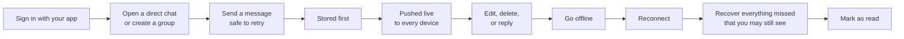

- integration with the host application's authentication and optional tenancy;
- direct conversations and group conversations with owner, admin, and member roles;
- durable text messages with safe retry (idempotency), editing, soft deletion, replies, and system messages;
- deterministic per-conversation ordering and cursor-based history;
- realtime delivery through SignalR from a transactional outbox, with typing indicators and single-instance presence;
- reconnection and missed-change synchronization, including membership changes;
- read positions, unread counts, conversation lists with filters and last-message previews;
- host extension points: authorization policy, message validator, audit sink, event subscriber, system messages;
- EF Core persistence for SQL Server and PostgreSQL (SQLite for development), health checks, logging, tracing, and metrics.

Attachments, reactions, threads, notifications, client SDKs, distributed presence, and hosted services will come later.

## How Soga works

### 1. Where Soga lives

Soga is a library inside your own ASP.NET Core application. Your app signs users in; Soga adds the messaging API, the realtime hub, and the tables in your database. Nothing runs outside your infrastructure.

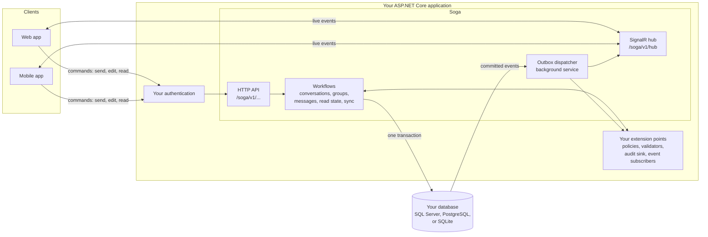

Commands always go over HTTP. The hub only delivers notifications. The database is the source of truth.

### 2. What happens on every request

Every request follows the same path. The user and tenant always come from your trusted server context, never from the request body. A conversation the caller does not belong to looks exactly like one that does not exist.

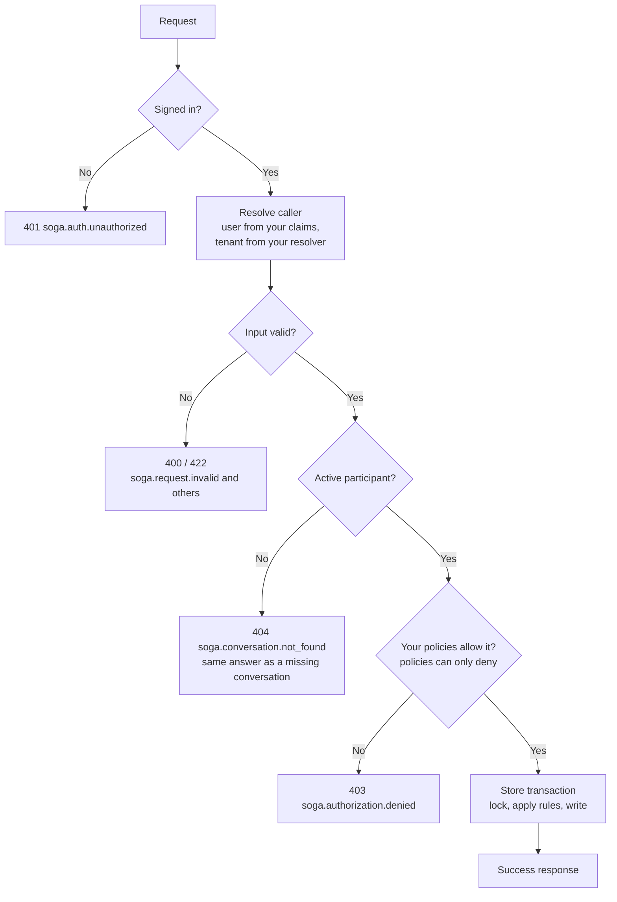

### 3. Sending a message

A message, its sync entry, and its outbox event are written in one transaction. Nothing is broadcast until that commit succeeds. The response and the live event can arrive in either order; clients match them by ID.

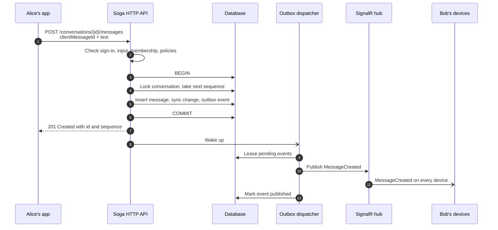

### 4. Retrying safely

Every send carries a `clientMessageId` chosen by the client. If the network fails, the client retries with the same ID and can never create a duplicate. The check uses a fingerprint of the text as first sent, so an edit made in between does not break a retry.

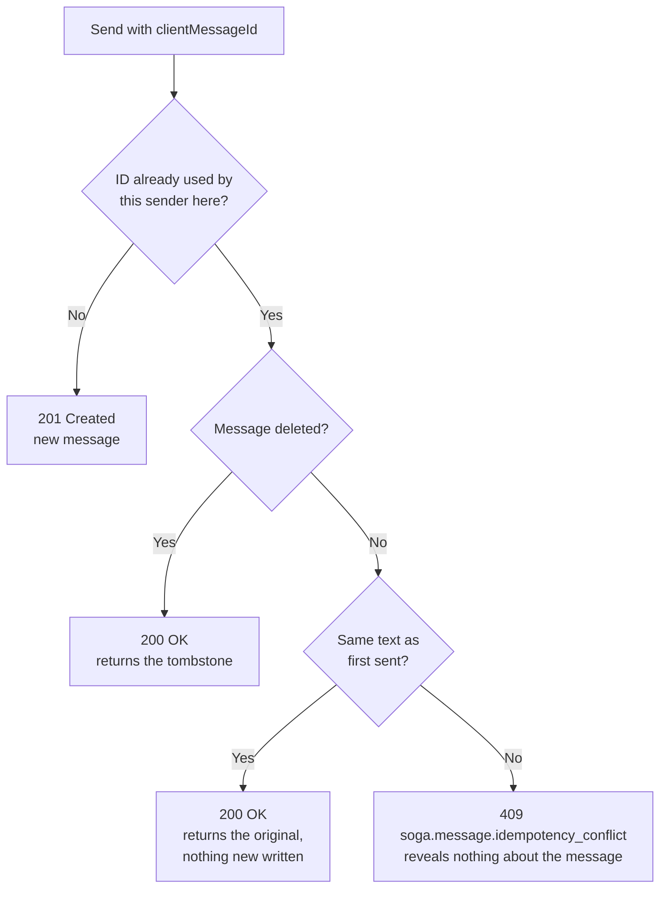

### 5. Delivering live events reliably

The outbox makes delivery survive crashes and outages. Events are leased so several servers never publish the same one at once. Failures are retried with growing delays. Delivery is at least once, so clients deduplicate by `eventId`.

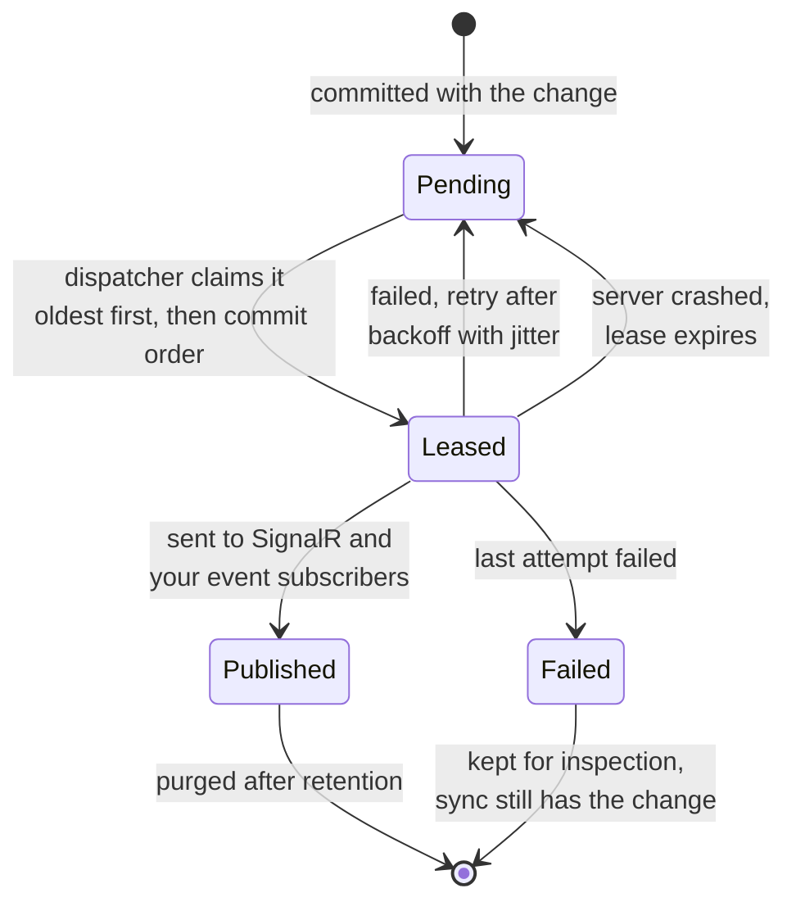

### 6. Going offline and coming back

Live events are hints. The sync log is the record. A client that was away asks for every change after its saved cursor and gets exactly what it missed, in order, limited to what it may still see.

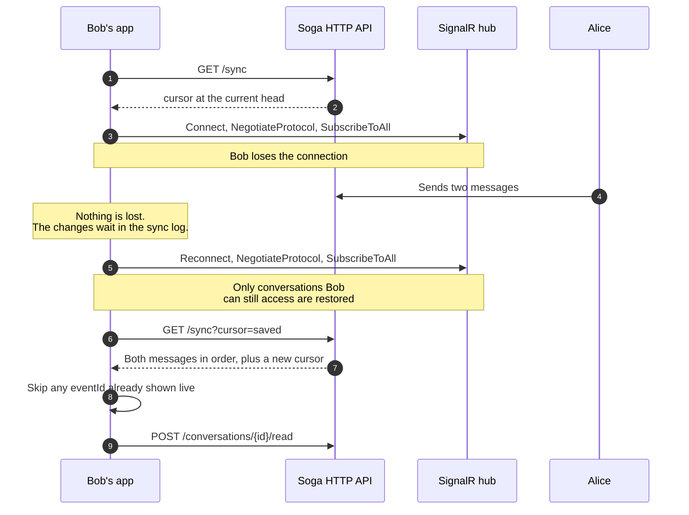

### 7. Groups and roles

A group always keeps at least one owner. Membership changes are decided inside one locked transaction, so two simultaneous changes can never leave a group without an owner. Removing someone cuts off their HTTP access, their sync, and every live connection on every device at once.

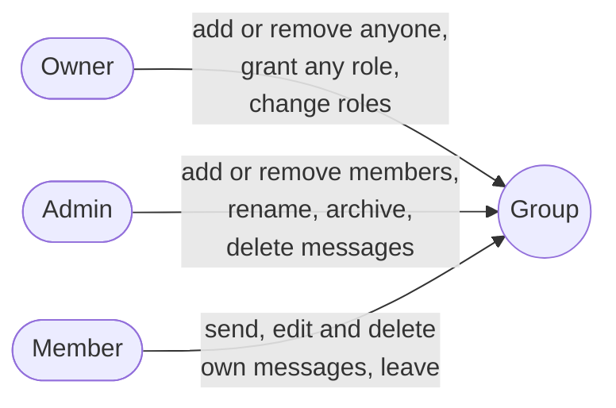

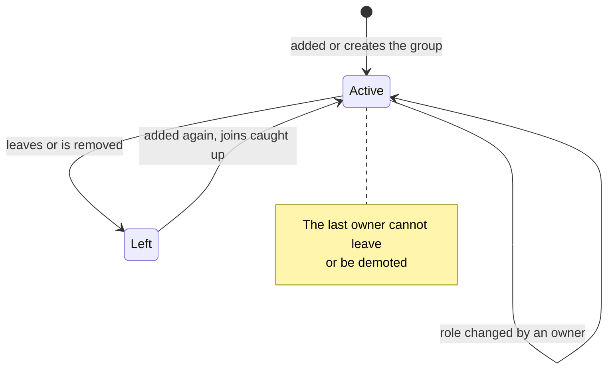

### 8. A message's life

The sequence never changes, so ordering stays stable. Deleting erases the text but keeps a tombstone, so the conversation has no gaps and replies can show "deleted". System messages come only from trusted server code and cannot be edited or deleted by anyone.

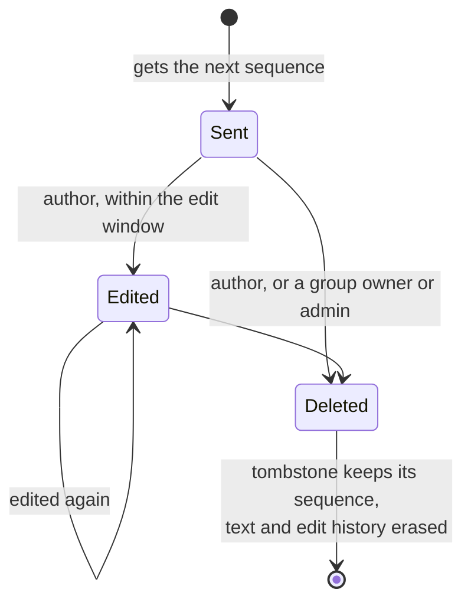

### 9. The tables Soga adds

Your application owns the migrations. Every key starts with the tenant, so tenants can never see each other's data. Soga never references your user table.

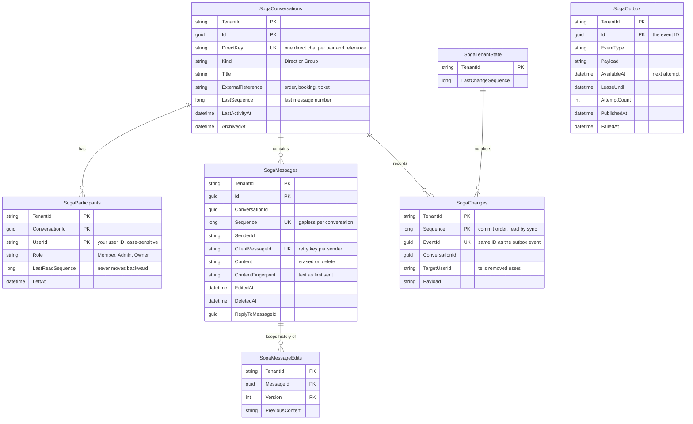

## Packages

| Package | Purpose |
|---|---|
| `Soga` | The ASP.NET Core messaging framework, protocol, SignalR integration, extension points, and in-memory development provider |
| `Soga.EntityFrameworkCore` | Relational database persistence using EF Core |

`Soga.Client` and a TypeScript client will be developed after the backend protocol is stable.

## Usage

```bash
dotnet add package Soga
dotnet add package Soga.EntityFrameworkCore
```

```csharp
builder.Services
    .AddSoga(options =>
    {
        options.RoutePrefix = "/soga/v1";
        options.Groups.MaximumParticipants = 256;
        options.Messages.MaximumTextLength = 8_000;
    })
    .UseEntityFrameworkCore<AppDbContext>();

app.MapSoga();
```

```csharp
// In your DbContext (SQL Server needs a case-sensitive collation for identity columns; see the deployment guide):
protected override void OnModelCreating(ModelBuilder modelBuilder) => modelBuilder.AddSoga();
```

Calling `MapSoga()` maps Soga's HTTP API and SignalR hub inside the developer's own application. `/soga/v1` is a configurable default prefix; it is not an external Soga service address. Your application owns the database migrations.

See [Getting started](docs/getting-started/README.md) for the full walkthrough, [Concepts](docs/concepts/README.md) for the HTTP API, roles, events, and error codes, and the [V1 to V2 migration guide](docs/migration/v1-to-v2.md) if you used the first preview.

## Build and test

```bash
dotnet restore
dotnet build -warnaserror
dotnet test
dotnet pack src/Soga/Soga.csproj -c Release -o artifacts/packages
dotnet pack src/Soga.EntityFrameworkCore/Soga.EntityFrameworkCore.csproj -c Release -o artifacts/packages
```

The SQL Server and PostgreSQL test suites run only when `SOGA_TEST_SQLSERVER` or `SOGA_TEST_POSTGRES` point at a server that may create databases; otherwise they are skipped.

```bash
dotnet run --project samples/Soga.MinimalSample
dotnet run --project samples/Soga.TeamChatSample
dotnet run --project samples/Soga.MarketplaceSample
```

## Design principles

- The database is the source of truth.
- Messages and changes are stored before realtime publication.
- SignalR is transport, not message storage.
- The authenticated user is determined by the host application.
- Every protected operation is authorized, and host rules can only restrict.
- Message sends are safe to retry.
- Disconnected clients can recover missed durable changes.
- Typing and presence are advisory and never grant access.
- Public contracts are separate from persistence entities.
- Single-server correctness comes before distributed scale-out.

## Documentation

- [Getting started](docs/getting-started/README.md)
- [Concepts, HTTP API, events, and errors](docs/concepts/README.md)
- [Security and threat model](docs/security/README.md)
- [Deployment and operations](docs/deployment/README.md)
- [V1 to V2 migration](docs/migration/v1-to-v2.md)
- [Architecture decisions](docs/decisions/)
- [Architecture and engineering guide](SOGA_ARCHITECTURE_AND_ENGINEERING_GUIDE.md)

## Contributing

Read `CONTRIBUTING.md`. Major architecture or public API changes should be discussed before implementation and documented through architecture decision records.

## Security

Soga requires authentication by default and does not trust client-supplied sender identities. Report vulnerabilities privately as described in `SECURITY.md`.

Soga uses HTTPS for transport security and does not provide end-to-end encryption.

## Ownership

Soga is created and maintained by Zhuwa Africa Limited.

## License

Soga is licensed under the Apache License 2.0. See `LICENSE` for details.
