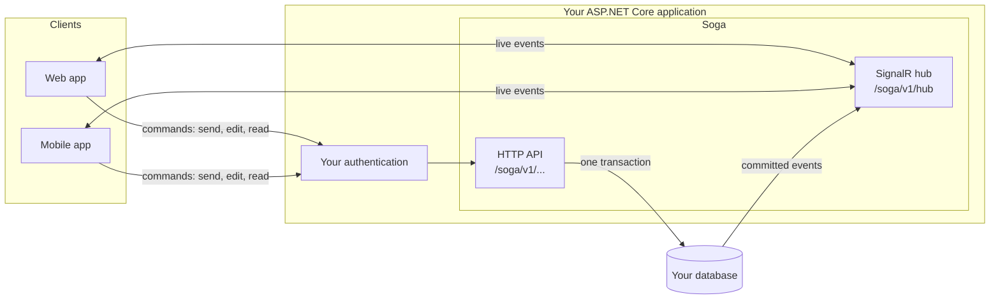

# Soga

<p align="center">
  
</p>

> Build conversations. Own your infrastructure.

Soga is an open-source, self-hosted messaging framework for ASP.NET Core. It adds the application layer you need above SignalR: direct and group conversations, persistent messages, roles, authorization, history, editing and deleting, read state, realtime events, and recovery after a disconnect.

Soga runs inside your own ASP.NET Core application. It is not a hosted service: you keep control of your users, database, messages, deployment and infrastructure.

**Contents:** [Why Soga?](#why-soga) · [Features](#features) · [How it fits](#how-it-fits) · [Requirements](#requirements) · [Installation](#installation) · [Quick start](#quick-start) · [Guarantees](#guarantees) · [Error handling](#error-handling) · [Going to production](#going-to-production) · [Packages](#packages) · [Samples](#samples) · [Documentation](#documentation) · [Contributing](#contributing) · [Security](#security) · [License](#license)

## Why Soga?

SignalR gives you realtime communication, but not a messaging domain. Teams still have to build message persistence, conversation membership, roles, permissions, duplicate-send protection, history, unread state, and recovery after a disconnect. Soga packages all of that into one ASP.NET Core framework.

## Features

- Your application's authentication, with optional tenancy.
- Direct conversations, and group conversations with owner, admin and member roles.
- Durable text messages: safe to retry, editable, soft-deletable, with replies and system messages.
- A fixed order per conversation and cursor-based history.
- Realtime delivery through SignalR from a transactional outbox, with typing indicators and single-server presence.
- Reconnection that recovers every change a user missed, including membership changes.
- Read positions, unread counts, and conversation lists with filters and last-message previews.
- Extension points for your own authorization policy, message validator, audit sink, event subscribers and system messages.
- EF Core storage for SQL Server and PostgreSQL (SQLite for development), plus health checks, logging, tracing and metrics.

Attachments, reactions, threads, notifications, client SDKs and distributed presence come later.

## How it fits

Your app signs users in; Soga adds the messaging API, the realtime hub, and the tables in your database. Nothing runs outside your infrastructure.



Commands always go over HTTP. The hub only delivers notifications. The database is the source of truth. [How Soga works](docs/architecture.md) explains each step with diagrams.

## Requirements

- .NET 10 or later.
- An ASP.NET Core application that already signs users in. Soga uses your users and never creates accounts.
- For production: SQL Server or PostgreSQL through EF Core. SQLite and the in-memory provider are for development only.

## Installation

```bash
dotnet add package Soga
dotnet add package Soga.EntityFrameworkCore
```

## Quick start

### 1. Register Soga

```csharp
builder.Services
    .AddSoga(options =>
    {
        options.RoutePrefix = "/soga/v1";
        options.Identity.UserIdClaimType = ClaimTypes.NameIdentifier;
        options.Messages.MaximumTextLength = 8_000;
        options.Groups.MaximumParticipants = 256;
    })
    .UseEntityFrameworkCore<AppDbContext>();

var app = builder.Build();
app.UseAuthentication();
app.UseAuthorization();
app.MapSoga();   // HTTP API and SignalR hub, under the route prefix
```

`MapSoga()` runs inside your application; `/soga/v1` is a configurable prefix, not an external service. Without `.UseEntityFrameworkCore`, Soga uses an in-memory provider for samples and development, which loses everything on restart.

### 2. Add the tables

Your `DbContext` owns the schema, and Soga never migrates your database for you:

```csharp
protected override void OnModelCreating(ModelBuilder modelBuilder)
{
    modelBuilder.AddSoga();   // PostgreSQL, SQLite

    // SQL Server is case-insensitive by default, which would treat "Alice" and "alice" as one user.
    // Soga refuses to start there without a case-sensitive collation:
    // modelBuilder.AddSoga(identityCollation: "Latin1_General_100_BIN2");
}
```

```bash
dotnet ef migrations add AddSoga
dotnet ef database update
```

### 3. Send a message

```bash
# Open (or fetch) the conversation between the signed-in user and bob.
POST /soga/v1/conversations/direct
{ "otherUserId": "bob", "externalReference": "order:1042" }     # reference is optional

# Send. clientMessageId is your idempotency key: retrying it never creates a duplicate.
POST /soga/v1/conversations/{id}/messages
{ "clientMessageId": "7f3c...", "text": "Is this still available?" }
```

The sender is always the authenticated user; a request cannot choose it.

### 4. Receive in realtime

```js
const connection = new signalR.HubConnectionBuilder()
  .withUrl("/soga/v1/hub", { accessTokenFactory: () => token })
  .withAutomaticReconnect()
  .build();

connection.on("MessageCreated", evt => { /* dedupe by evt.eventId, order by evt.sequence */ });

await connection.start();
await connection.invoke("NegotiateProtocol", 1);   // wait for it: the connection is now fully set up
await connection.invoke("SubscribeToAll");         // call again after every reconnect
```

Other events include `MessageUpdated`, `MessageDeleted`, `ParticipantChanged`, `ReadPositionChanged`, `TypingChanged` and `PresenceChanged`. Clients must ignore event types and fields they do not know.

### 5. Recover after a disconnect

Live events are hints; the sync log is the record. Keep a cursor and use it after reconnecting:

```text
GET /soga/v1/sync                 -> { events: [], cursor: "A", hasMore: false }   (first start)
... disconnected, things happen ...
GET /soga/v1/sync?cursor=A        -> { events: [...], cursor: "B", hasMore: false }
```

Apply the events, skip any `eventId` you already showed live, and store the new cursor. While `hasMore` is true, call again. Edits, deletions and membership changes are all in sync; typing and presence are not.

### 6. Groups and roles

```bash
POST   /soga/v1/conversations/groups                      { "title": "Launch team", "participantUserIds": ["bob", "carol"] }
POST   /soga/v1/conversations/{id}/participants           { "userId": "dave", "role": "admin" }
PUT    /soga/v1/conversations/{id}/participants/bob/role  { "role": "admin" }
DELETE /soga/v1/conversations/{id}/participants/carol     # remove; DELETE your own ID to leave
```

The creator is the owner. Owners and admins add and remove members, rename, archive and delete others' messages; only owners change roles or remove admins and owners. A group always keeps at least one owner.

### 7. Add your own rules

```csharp
// "Only the buyer and seller of an order may talk about it." A policy can only deny, never grant.
builder.Services.AddScoped<ISogaAuthorizationPolicy, OrderConversationPolicy>();
builder.Services.AddSingleton<ISogaMessageValidator, NoLinksValidator>();   // reject a message with a reason code
builder.Services.AddSingleton<ISogaAuditSink, MyAuditSink>();               // privileged operations, never message text
```

[Getting started](docs/getting-started/README.md) covers each step in full, including editing, deleting, replies, typing and presence.

## Guarantees

1. Only authorized users can access a conversation, over HTTP and SignalR alike.
2. An accepted message is durable: it is stored with its sync change and outbox event in one transaction before anything is announced.
3. A retry does not create a duplicate.
4. Messages in a conversation have a fixed order that editing and deleting never change.
5. A disconnected client recovers everything it missed that it is still allowed to see.
6. Read state stays correct.
7. A removed participant loses access immediately, on every device.

Realtime delivery is at least once, never exactly once, so clients deduplicate by `eventId`.

## Error handling

Errors are `application/problem+json` with a stable `code`. Branch on `code`, never on the English text, and ignore codes you do not know.

| Code | Status | Meaning |
| --- | --- | --- |
| `soga.auth.unauthorized` | 401 | No authenticated user |
| `soga.authorization.denied` | 403 | Your role or a host policy does not allow it |
| `soga.conversation.not_found` | 404 | Missing, inaccessible, or another tenant's: the same answer, so private conversations cannot be discovered |
| `soga.conversation.archived` | 409 | Archived conversations take no new messages |
| `soga.group.last_owner` | 409 | A group must keep an owner |
| `soga.message.idempotency_conflict` | 409 | The same `clientMessageId` was reused for different text |
| `soga.message.too_long` | 422 | Text over the limit |
| `soga.message.rejected` | 422 | Your validator refused it; `detail` holds its reason code |
| `soga.rate_limited` | 429 | Rate limit exceeded |

The full list is in [Concepts](docs/concepts/README.md#errors).

## Going to production

- Use `.UseEntityFrameworkCore<T>()`, and review and apply the migration through your normal process.
- On SQL Server, pass the case-sensitive `identityCollation`.
- Serve HTTPS only, with real authentication whose user ID claim matches `Soga:Identity:UserIdClaimType`.
- Persist and share Data Protection keys across instances; sync cursors depend on them.
- Register a rate-limit policy and your own authorization rules for who may start conversations or create groups.
- Run one realtime instance, or configure a SignalR backplane yourself.

The full checklist, configuration and operations guide is in [Deployment](docs/deployment/README.md).

## Packages

| Package | Purpose |
| --- | --- |
| `Soga` | The messaging framework: HTTP API, SignalR hub, protocol, extension points, and an in-memory provider for development |
| `Soga.EntityFrameworkCore` | Database storage through EF Core |

A .NET client (`Soga.Client`, for Blazor, MAUI, desktop and console apps) is planned in this repository; see [ADR 0018](docs/decisions/0018-client-sdks-in-this-repository.md).

## Samples

```bash
dotnet run --project samples/Soga.MinimalSample        # in-memory, the smallest setup
dotnet run --project samples/Soga.TeamChatSample       # groups, roles, audit, system messages, host rules
dotnet run --project samples/Soga.MarketplaceSample    # EF Core + SQLite, one conversation per order
```

The samples trust an `X-Soga-User` header to stay short. Never do that in production.

## Documentation

- [Getting started](docs/getting-started/README.md): every step above in full
- [Concepts](docs/concepts/README.md): conversations, roles, messages, sync, events, the HTTP API and every error code
- [How Soga works](docs/architecture.md): diagrams of requests, sending, retries, live delivery, reconnection, groups and tables
- [Security](docs/security/README.md): trust model, threat model, known limits
- [Deployment](docs/deployment/README.md): production checklist, databases, configuration, operations
- [V1 to V2 migration](docs/migration/v1-to-v2.md)
- [Architecture decisions](docs/decisions/) and the [architecture and engineering guide](SOGA_ARCHITECTURE_AND_ENGINEERING_GUIDE.md)

## Contributing

```bash
dotnet build -warnaserror
dotnet test
```

The SQL Server and PostgreSQL test suites run only when `SOGA_TEST_SQLSERVER` or `SOGA_TEST_POSTGRES` point at a server that may create databases. Read [CONTRIBUTING.md](CONTRIBUTING.md) before you start; discuss major architecture or public API changes first and record them as architecture decisions.

## Security

Soga requires authentication by default and never trusts a sender identity sent by a client. It relies on HTTPS for transport security and does not provide end-to-end encryption. Report vulnerabilities privately as described in [SECURITY.md](SECURITY.md).

## License

Soga is created and maintained by Zhuwa Africa Limited and licensed under the [Apache License 2.0](LICENSE).
