# How Soga works

This page explains Soga's design with diagrams: where it runs, what happens on each request, and how messages, retries, live events, reconnection, groups and storage work. To use Soga, start with [Getting started](getting-started/README.md); the binding engineering rules are in the [architecture and engineering guide](../SOGA_ARCHITECTURE_AND_ENGINEERING_GUIDE.md) and the [decision records](decisions/).

## A conversation from start to finish

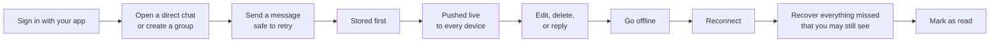

## 1. Where Soga lives

Soga is a library inside your own ASP.NET Core application. Your app signs users in; Soga adds the messaging API, the realtime hub, and the tables in your database. Nothing runs outside your infrastructure.

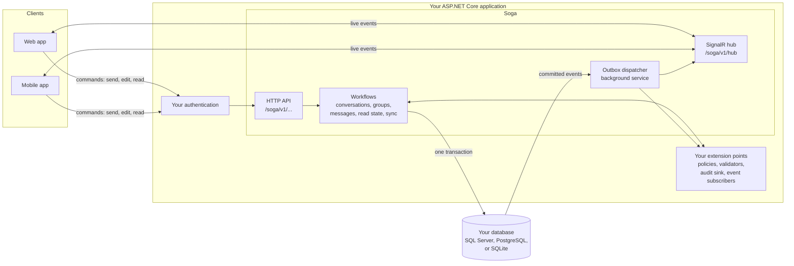

Commands always go over HTTP. The hub only delivers notifications. The database is the source of truth.

## 2. What happens on every request

Every request follows the same path. The user and tenant always come from your trusted server context, never from the request body. A conversation the caller does not belong to looks exactly like one that does not exist.

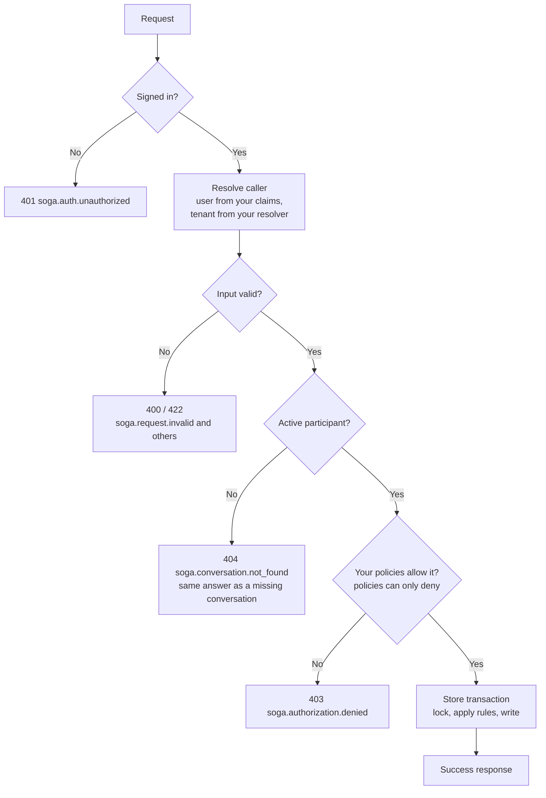

## 3. Sending a message

A message, its sync entry, and its outbox event are written in one transaction. Nothing is broadcast until that commit succeeds. The response and the live event can arrive in either order; clients match them by ID.

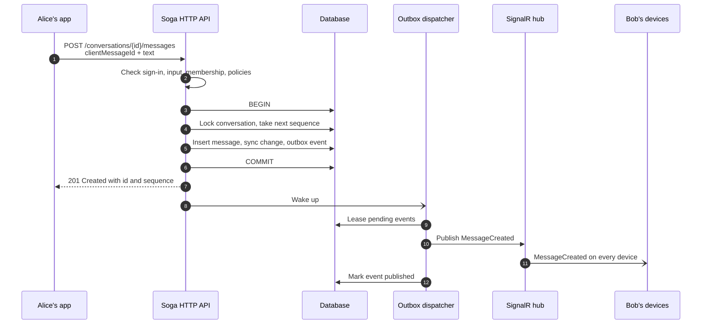

## 4. Retrying safely

Every send carries a `clientMessageId` chosen by the client. If the network fails, the client retries with the same ID and can never create a duplicate. The check uses a fingerprint of the text as first sent, so an edit made in between does not break a retry.

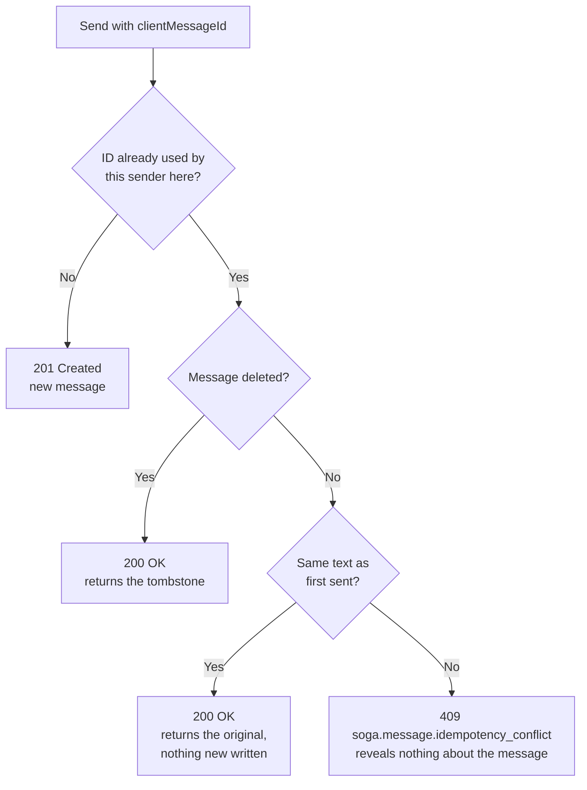

## 5. Delivering live events reliably

The outbox makes delivery survive crashes and outages. Events are leased so several servers never publish the same one at once. Failures are retried with growing delays. Delivery is at least once, so clients deduplicate by `eventId`.

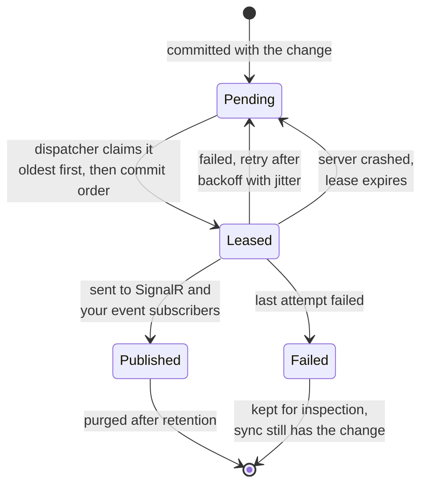

## 6. Going offline and coming back

Live events are hints. The sync log is the record. A client that was away asks for every change after its saved cursor and gets exactly what it missed, in order, limited to what it may still see.

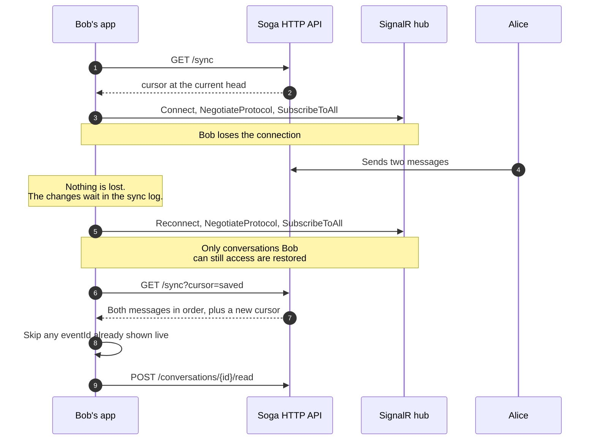

## 7. Groups and roles

A group always keeps at least one owner. Membership changes are decided inside one locked transaction, so two simultaneous changes can never leave a group without an owner. Removing someone cuts off their HTTP access, their sync, and every live connection on every device at once.

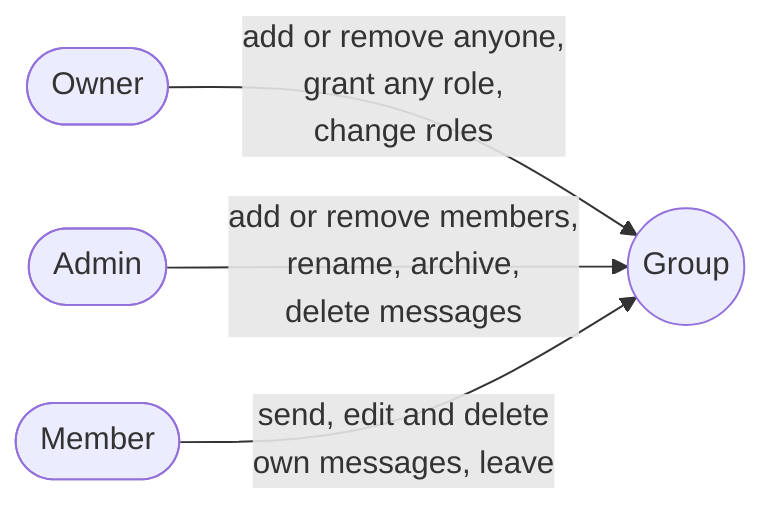

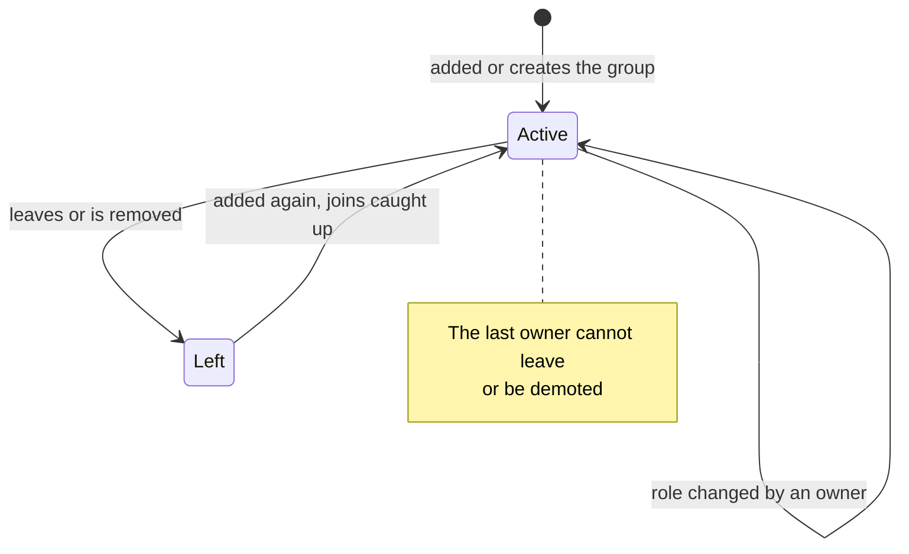

## 8. A message's life

The sequence never changes, so ordering stays stable. Deleting erases the text but keeps a tombstone, so the conversation has no gaps and replies can show "deleted". System messages come only from trusted server code and cannot be edited or deleted by anyone.

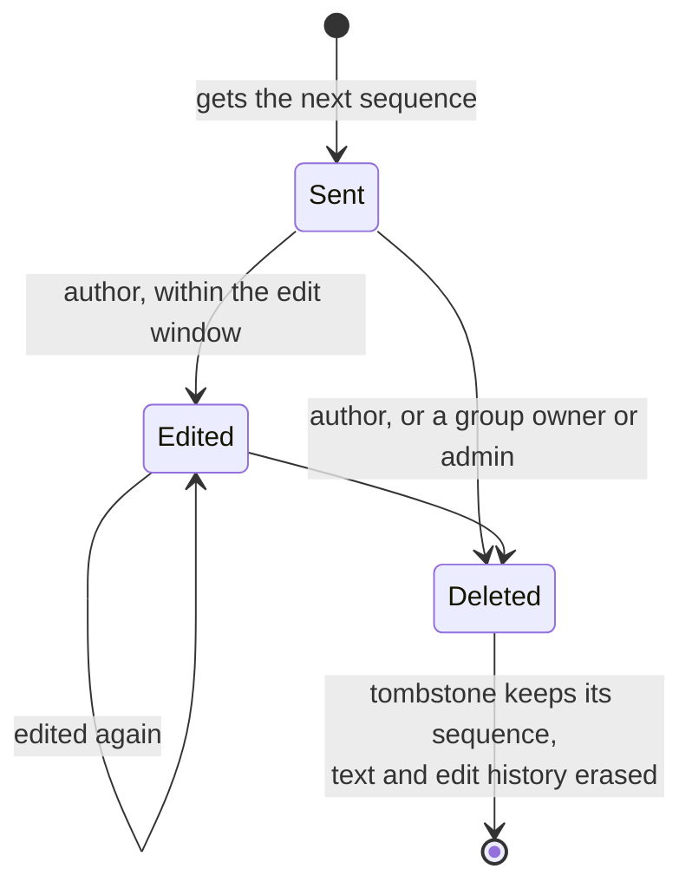

## 9. The tables Soga adds

Your application owns the migrations. Every key starts with the tenant, so tenants can never see each other's data. Soga never references your user table.

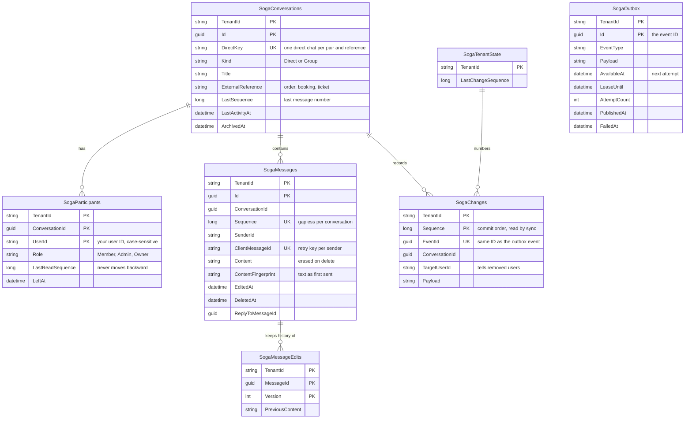

## Design principles

- The database is the source of truth.
- Messages and changes are stored before realtime publication.
- SignalR is transport, not message storage.
- The authenticated user is determined by the host application.
- Every protected operation is authorized, and host rules can only restrict.
- Message sends are safe to retry.
- Disconnected clients can recover missed durable changes.
- Typing and presence are advisory and never grant access.
- Public contracts are separate from persistence entities.
- Single-server correctness comes before distributed scale-out.
